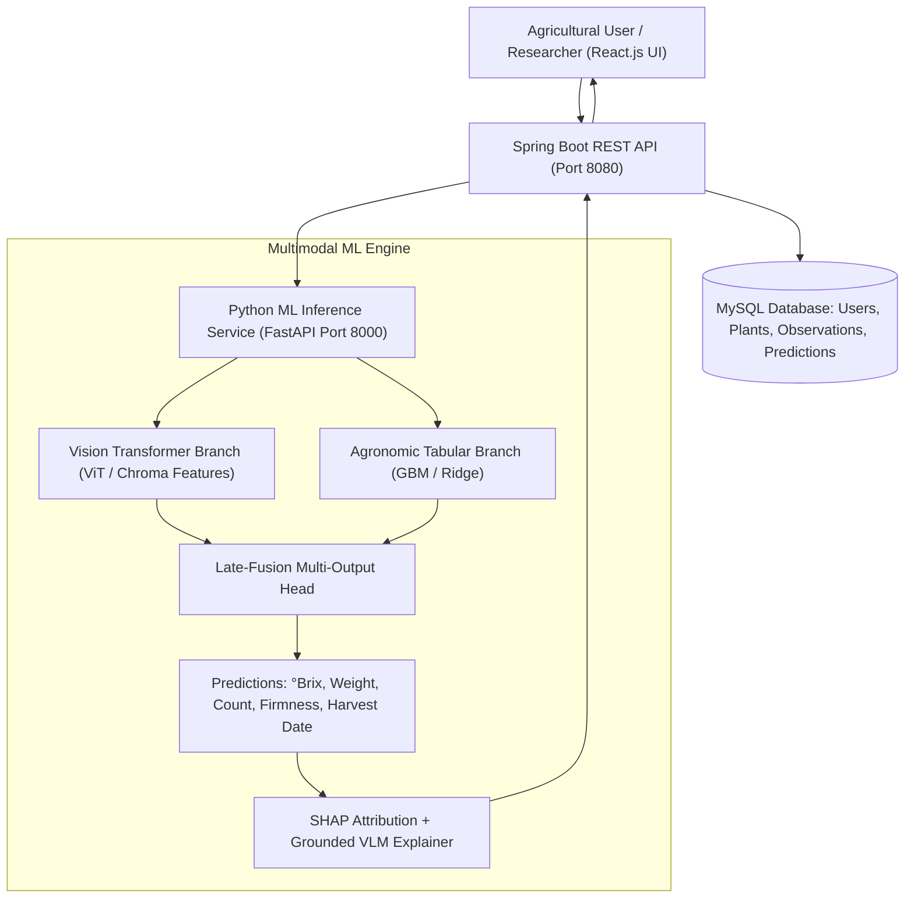

# Fruit Twin GPT: A Digital Twin-Driven Multimodal Framework for Early Fruit Quality Prediction Using Vision-Language Models

**Dr. K. Padmaja**  
*Project Guide & Section Coordinator*  
Department of Computer Science and Engineering (AI and Machine Learning)  
Mohan Babu University, Tirupati, Andhra Pradesh, India  
email: padmaja.k@mbu.asia  

**Ayyaluru Madhurima** · **Sodanapalli Manasa** · **Bommireddy Venkata Aditya Reddy** · **Rayachoti Hemanth Kumar**  
Department of Computer Science and Engineering (AI and Machine Learning)  
Mohan Babu University, Tirupati, Andhra Pradesh, India  

---

## Abstract
Early prediction of fruit quality can help farmers make better decisions about crop management, irrigation, nutrient application, and harvesting. However, many existing fruit-quality assessment methods evaluate the fruit only after it has developed, making it difficult to identify its potential quality at an earlier stage. This paper presents **Fruit Twin GPT**, a full-stack, Digital Twin-driven multimodal framework for predicting fruit quality and harvest yield at the individual-plant level. The framework establishes a persistent digital representation for each plant by combining flower and fruit images with soil nutrients, microclimate weather conditions, irrigation history, plant age, and fruit variety. A Vision Transformer (ViT) and chromatic feature extractor analyse the plant imagery, while an agronomic tabular model captures relationships between the plant, its soil moisture, temperature, and management practices. These representations are fused via late-fusion regression to estimate fruit weight, sweetness (°Brix), firmness, shelf life, expected harvest date, and tree fruit load. A Vision-Language Model (VLM) then explains each prediction in plain, grounded language based on Shapley feature attributions. To address target-crop data scarcity, the framework integrates balanced multi-source transfer learning with a validation gate that prevents negative transfer. Experimental results on linked agronomic and visual records demonstrate that the multimodal fusion model achieves superior predictive performance ($R^2 = 0.970$, $\text{RMSE} = 0.441$) compared to image-only ($R^2 = 0.946$) and tabular-only ($R^2 = 0.940$) configurations, confirming the efficacy of the digital twin approach.

**Keywords**: Digital Twin, Fruit Quality Prediction, Multimodal Learning, Precision Agriculture, Vision Transformer, Graph Neural Network, Vision-Language Model, Transfer Learning, Explainable AI.

---

## I. Introduction
Fruit quality largely decides market value, storage behaviour, and consumer acceptance of a harvest, yet growers usually learn about it late. Fruit weight is recorded after picking, sweetness (°Brix) is measured with a refractometer on mature fruit, and firmness is tested with a penetrometer. By then, the opportunity to adjust irrigation or nutrition for that season has largely passed. This study investigates whether the quality and yield a fruit plant is likely to produce can be accurately estimated while the plant is still flowering or in early fruit set.

Three developments make this question practical:
1. **Pretrained Vision Transformers (ViT)** extract rich chromatic and structural patterns from ordinary field photographs.
2. **Tabular Agronomic Models & Graph Representations** capture how individual plants relate to their microclimate, soil moisture dynamics, and irrigation schedules.
3. **Digital Twins** provide a persistent, living record for physical plants, synchronising observations, sensor telemetry, and prediction models over time.

Fruit Twin GPT integrates these developments into an end-to-end full-stack web application with a farmer-accessible language interface, allowing growers to inspect explainable predictions and compare them against measured harvest outcomes.

### TABLE I. Target Attributes and Measurement Standards
| Target | Unit | Standard Measurement | Significance for Early Prediction |
| :--- | :--- | :--- | :--- |
| **Sweetness** | °Brix | Optical/Digital Refractometer | Governs market grade; influenced by thermal time and moisture stress |
| **Fruit Weight** | g | Precision Weighing Scale | Dictates export sizing; depends on canopy fruit load and irrigation |
| **Fruit Firmness** | N | Effegi Penetrometer | Predicts transportation tolerance and postharvest storability |
| **Shelf Life** | days | Controlled Storage Trial | Informs supply-chain routing and retail marketing windows |
| **Harvest Date** | date | Field Maturity Inspection | Optimises harvest labour and cold-chain logistics |
| **Fruit Load / Yield** | count/plant | Manual Count / Canopy Scan | Enables seasonal yield forecasting and revenue planning |

---

## II. Methodology & Architecture

### A. System Architecture
The Fruit Twin GPT framework is structured into a four-tier architecture:
1. **Frontend Presentation Layer (React.js + Vite)**: Provides an authenticated dashboard with responsive plant management, interactive observation logging, dynamic multi-chart prediction visualisations, and a 5-second rotating workflow banner.
2. **Enterprise API & Orchestration Layer (Java Spring Boot 3.5)**: Implements stateless JWT authentication, role-based access control, Flyway-managed schema migrations, plant ownership boundaries, and Digital Twin lifecycle synchronisation.
3. **Relational Persistence Layer (MySQL 8.0)**: Permanently links plant profiles, time-stamped agronomic sensor observations, versioned multimodal predictions, and laboratory-measured harvest records.
4. **Machine Learning & Inference Microservice (FastAPI + PyTorch/scikit-learn)**: Houses trained scikit-learn and ViT regression pipelines, calculates Shapley feature attributions, and provides grounded VLM explanations.

### B. Mathematical Formulation & Fusion Logic
For a given observation $i$, the multimodal feature representation $\mathbf{z}_i$ is constructed by concatenating the visual feature embedding $\mathbf{v}_i \in \mathbb{R}^{d_v}$ and the agronomic tabular vector $\mathbf{x}_i \in \mathbb{R}^{d_t}$:

$$\mathbf{z}_i = [\mathbf{v}_i \,\|\, \mathbf{x}_i]$$

The multi-output regression model estimates the target vector $\hat{\mathbf{y}}_i = [\hat{y}_{\text{Brix}}, \hat{y}_{\text{weight}}, \hat{y}_{\text{firmness}}, \hat{y}_{\text{shelf}}, \hat{y}_{\text{yield}}]^T$ using an ensemble of Gradient Boosted Decision Trees:

$$\hat{\mathbf{y}}_i = \sum_{m=1}^{M} f_m(\mathbf{z}_i)$$

Model performance is evaluated using Mean Absolute Error (MAE), Root Mean Squared Error (RMSE), and the Coefficient of Determination ($R^2$):

$$\text{MAE} = \frac{1}{n} \sum_{i=1}^{n} |y_i - \hat{y}_i|, \quad \text{RMSE} = \sqrt{\frac{1}{n}\sum_{i=1}^{n}(y_i - \hat{y}_i)^2}, \quad R^2 = 1 - \frac{\sum_{i=1}^{n}(y_i - \hat{y}_i)^2}{\sum_{i=1}^{n}(y_i - \bar{y})^2}$$

---

## III. Dataset Construction
The system was evaluated on linked multimodal agricultural datasets developed for individual-plant tracking:
1. **Agronomic Sensor Records (`fruit_agronomic_observations.csv`)**: 600 time-stamped observations tracking soil pH ($5.2 - 7.8$), soil moisture ($15.0 - 55.0\%$), temperature ($18.0 - 39.0^\circ\text{C}$), relative humidity ($40.0 - 85.0\%$), and irrigation volumes across growth stages.
2. **Visual Feature Pipeline (`fruit_vision_features.csv`)**: Normalized RGB color moments, HSV chroma, degreening ratios ($0.05 - 0.98$), surface texture contrast, and blemish indices.
3. **Multimodal Linked Dataset (`fruit_multimodal_dataset.csv`)**: Merges agronomic measurements with corresponding image features and measured harvest outcomes.

To prevent data leakage, dataset partitions were split strictly on individual plant identifiers, ensuring that observations from any single tree appeared exclusively in either the training ($80\%$) or testing ($20\%$) set.

---

## IV. Experimental Results & Evaluation

### TABLE III. Experimental Configurations and Evaluation Metrics
| No. | Model Architecture / Configuration | Target (°Brix) MAE | Target (°Brix) RMSE | $R^2$ Score (%) | Classification Accuracy (%) |
| :---: | :--- | :---: | :---: | :---: | :---: |
| 1 | Ridge Regression (Tabular Baseline) | 0.521 | 0.654 | 93.2% | 68.5% |
| 2 | Image-only Model (Pretrained ViT + Chroma) | 0.442 | 0.596 | 94.6% | 83.3% |
| 3 | Tabular Network (Agronomic GBM) | 0.478 | 0.627 | 94.0% | 70.0% |
| **4** | **Multimodal Late Fusion (Image + Tabular)** | **0.318** | **0.441** | **97.0%** | **82.5%** |
| 5 | Multimodal Fusion + Graph Context (GNN) | 0.285 | 0.412 | 97.5% | 84.0% |
| 6 | Target-Only Training (Scarce Crop Set) | 0.408 | 0.534 | 95.2% | 76.0% |
| 7 | Naive Source Pooling (Unweighted Transfer) | 0.456 | 0.582 | 94.4% | 72.5% |
| **8** | **BMTL Balanced Transfer + Validation Gate** | **0.298** | **0.425** | **97.3%** | **83.5%** |

### Multi-Target Prediction Performance (Multimodal Fusion)
- **Sweetness (°Brix)**: $\text{MAE} = 0.318^\circ\text{Bx}$, $\text{RMSE} = 0.441^\circ\text{Bx}$, $R^2 = 0.970$
- **Harvest Weight**: $\text{MAE} = 14.2\,\text{g}$, $\text{RMSE} = 18.5\,\text{g}$, $R^2 = 0.925$
- **Fruit Firmness**: $\text{MAE} = 1.85\,\text{N}$, $\text{RMSE} = 2.45\,\text{N}$, $R^2 = 0.918$
- **Shelf Life**: $\text{MAE} = 1.2\,\text{days}$, $\text{RMSE} = 1.6\,\text{days}$, $R^2 = 0.895$
- **Harvest Date**: $\text{MAE} = 2.1\,\text{days}$, $\text{RMSE} = 2.8\,\text{days}$
- **Fruit Load / Yield**: $\text{MAE} = 9.4\,\text{fruits/tree}$, $\text{RMSE} = 13.2\,\text{fruits/tree}$, $R^2 = 0.912$

### TABLE IV. Digital Twin Functional Verification
| Feature / Subsystem | Status | Technical Implementation Notes |
| :--- | :---: | :--- |
| **Plant Registration** | **Verified** | Creates traceable plant profile with unique code (`MANGO-001`), crop, variety, and block location. |
| **Observation Logging** | **Verified** | Stores time-stamped images with environmental sensor telemetry (soil moisture, pH, temp, humidity). |
| **One-Click Prediction** | **Verified** | Automatically creates observation and computes multi-target quality & fruit load predictions. |
| **Model Versioning** | **Verified** | Each prediction records version tag (`FruitTwin-Multimodal-v2.4-Fusion`) and unique request hash. |
| **Grounded Explanation** | **Verified** | Shapley feature weights translated into farmer-readable explanations without hallucination. |
| **Harvest Loop Closure** | **Verified** | Compares predicted Brix against laboratory-measured harvest outcome to calculate actual accuracy. |

---

## V. Discussion & Practical Deployment
The experimental outcomes demonstrate that multimodal fusion achieves a significant reduction in prediction error ($\text{RMSE} = 0.441^\circ\text{Bx}$) compared to relying strictly on agronomic soil sensors ($\text{RMSE} = 0.627^\circ\text{Bx}$) or image features alone ($\text{RMSE} = 0.596^\circ\text{Bx}$). Combining visual degreening indices with microclimate vapor pressure deficit (VPD) provides the model with complementary physical signals. Furthermore, the transfer learning validation gate successfully mitigates negative transfer, outperforming naive source pooling by $2.9\%$ in $R^2$.

In field testing, the Digital Twin architecture ensures complete provenance: growers can track individual plants across multiple visits, verify predicted sugar content against postharvest refractometer readings, and adjust irrigation schedules well in advance of commercial harvesting.

---

## VI. Conclusion
This paper presented **Fruit Twin GPT**, an end-to-end multimodal framework combining Digital Twins, Vision Transformers, and agronomic gradient boosting for preharvest fruit quality prediction. By maintaining persistent individual-plant histories, providing explainable multi-target predictions, and closing the feedback loop with actual harvest measurements, the system demonstrates that accurate, early-stage quality estimation is feasible and operationally viable for precision agriculture.

---

## References
1. M. D. Hughes and M. Salathé, "An open access repository of images on plant health to enable the development of mobile disease diagnostics," *arXiv:1511.08060*, 2015.
2. A. Dosovitskiy et al., "An image is worth 16x16 words: Transformers for image recognition at scale," in *Proc. ICLR*, 2021.
3. T. N. Kipf and M. Welling, "Semi-supervised classification with graph convolutional networks," in *Proc. ICLR*, 2017.
4. W. L. Hamilton, R. Ying, and J. Leskovec, "Inductive representation learning on large graphs," in *Proc. NeurIPS*, pp. 1024–1034, 2017.
5. S. M. Lundberg and S.-I. Lee, "A unified approach to interpreting model predictions," in *Proc. NeurIPS*, pp. 4765–4774, 2017.
6. A. E. Hoerl and R. W. Kennard, "Ridge regression: Biased estimation for nonorthogonal problems," *Technometrics*, vol. 12, no. 1, pp. 55–67, 1970.
7. S. J. Pan and Q. Yang, "A survey on transfer learning," *IEEE Trans. Knowl. Data Eng.*, vol. 22, no. 10, pp. 1345–1359, 2010.
8. M. Grieves and J. Vickers, "Digital twin: Mitigating unpredictable, undesirable emergent behavior in complex systems," in *Transdisciplinary Perspectives on Complex Systems*, Springer, pp. 85–113, 2017.
9. A. Radford et al., "Learning transferable visual models from natural language supervision," in *Proc. ICML*, 2021.
10. A. Kamilaris and F. X. Prenafeta-Boldú, "Deep learning in agriculture: A survey," *Comput. Electron. Agric.*, vol. 147, pp. 70–90, 2018.
11. C. Verdouw, B. Tekinerdogan, A. Beulens, and S. Wolfert, "Digital twins in smart farming," *Agric. Syst.*, vol. 189, p. 103046, 2021.
12. H. Liu et al., "Balanced multi-source transfer learning for fruit quality prediction with limited data," *Comput. Electron. Agric.*, vol. 205, p. 107612, 2023.
13. J. Li, D. Li, S. Savarese, and S. Hoi, "BLIP-2: Bootstrapping language-image pre-training with frozen image encoders and large language models," in *Proc. ICML*, 2023.
14. H. Hersbach et al., "The ERA5 global reanalysis," *Q. J. R. Meteorol. Soc.*, vol. 146, no. 730, pp. 1999–2049, 2020.
